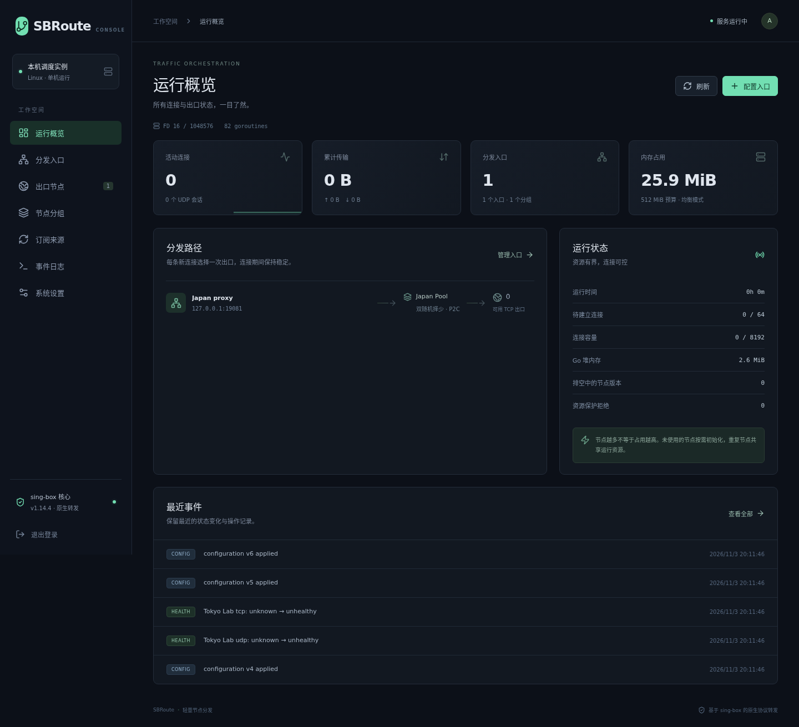

# SBRoute

Linux 单机节点分流器。使用官方 sing-box 1.14.4 协议实现，按入口端口把新连接分发到指定节点组；中文 Web 面板、单进程、静态前端，无需 Node.js 运行环境或外部数据库。



程序入口为 `cmd/sbroute`。

## 能力

- 同一入口提供 HTTP / HTTPS CONNECT / SOCKS5，SOCKS5 支持 UDP；也可配置固定目标 TCP/UDP 转发。
- 随机、轮询、源 IP 一致性哈希、最小业务连接数、优先级故障转移、P2C 双随机择少。
- 分享链接、Base64 订阅、Clash YAML、sing-box JSON 节点导入；支持 SOCKS、HTTP、SS、VMess、VLESS、Trojan、AnyTLS、Hysteria2、TUIC。
- 手动分组与按订阅、关键词、正则的动态分组；手动成员可排序，作为故障转移优先级。
- TCP/UDP 独立健康状态、共享探测、故障退避、配置版本和回滚；异常订阅更新先审核。
- SQLite 持久化、完整备份恢复、脱敏导出、实时事件推送、节点出口 IP（含 IPv6）按需查询。
- 订阅可自定义 User-Agent、经由指定节点下载，并显示服务商返回的已用流量与到期时间。
- 全局业务计数、重复节点运行时去重、同组调度表共享、连接排空与资源准入保护。

## 在 Linux 开始使用

从 [Releases](https://github.com/tionmon/sbroute/releases) 下载对应架构（amd64 / arm64）的发布包并校验 `SHA256SUMS`，解压后：

```bash
chmod +x sbroute
./sbroute admin --data-dir ./data
./sbroute serve --data-dir ./data --listen 127.0.0.1:8080
```

管理员密码为 12–72 字节，交互输入不回显。可用 `--password-stdin` 从管道输入；没有默认密码。数据目录仅当前用户可读。

从本机通过 SSH 隧道打开面板：

```bash
ssh -N -L 8080:127.0.0.1:8080 YOUR_SERVER
```

访问 `http://127.0.0.1:8080`，依次完成：**导入节点或添加订阅 → 建立节点组 → 创建分发入口**。默认入口只监听回环地址；需要其他设备使用时，在入口中明确配置监听地址、认证或来源白名单。

## 分发语义

| 策略 | 行为 |
| --- | --- |
| `round_robin` | 每个入口循环分配健康节点，默认策略 |
| `random` | 每次新建出站连接随机选择健康节点 |
| `ip_hash` | 入口 ID + 源 IP 的稳定一致性哈希；成员增减尽量减少迁移 |
| `least_conn` | 选择全局业务连接及待建连接总数最小者；候选池较大时扫描开销高于 P2C |
| `failover` | 按组顺序使用健康节点，恢复节点稳定 30 秒后回切；没有其他可用节点时允许直接使用恢复节点 |
| `p2c` | 随机抽两个节点，选择业务负载较少者，适合大组和高建连频率 |

连接/会话一旦选中出口就保持，不逐包换节点，不解密 HTTPS。同一 NAT 后的客户端共享来源 IP。HTTP keep-alive、HTTP/2 与应用连接池会复用已建立连接，因此刷新页面不一定换出口，也不保证每个请求换 IP。不同节点可能共享公网出口地址。

UDP 使用核心会话边界：固定目标按来源建立会话，SOCKS5 association 内不同目标保持同一节点。原生 HTTP 代理不承载普通 UDP。

组内没有可用节点时拒绝连接，**不降级为直连**。只在拨号返回错误且尚未提交业务数据时重试，最多三个不同节点，共享 10 秒建连预算。核心延迟握手后发生的错误不重放；已经建立的连接故障由客户端重连。

## 资源与运行

默认预算为 512MiB，Go 内存软限制取有效预算约 70%；机器/容器限制更小时自动下调。监控进程 RSS 与 cgroup 内存，接近限额时暂停非必要后台工作并拒绝新会话，保留已有连接；低于恢复水位再放行。软限制不是内核硬限制。

| 参数 | 省内存 | 均衡 | 高吞吐 |
| --- | ---: | ---: | ---: |
| 业务连接/会话上限 | 4096 | 8192 | 16384 |
| UDP 子上限 | 1024 | 2048 | 4096 |
| 并行建连 | 16 | 64 | 128 |
| 探测并发 | 2 | 4 | 8 |
| 活跃探测周期 | 180s | 120s | 60s |
| 默认 UDP 空闲超时 | 30s | 60s | 60s |

面板切换预设保留当前内存预算和已启动入口的 UDP 超时；其余限制可实时调整。手动修改 UDP 超时、入口认证、入口协议、固定目标或同一地址端口的监听配置，需要先禁用该入口并保存，再修改启用。这样不会在保存失败时丢失旧监听。组成员、调度策略、白名单和节点名称可直接应用。

未被启用入口引用的节点不会自动探测。活跃组闲置 30 分钟后停止周期探测，重新使用时触发候选检查。相同节点/网络共用探测，失败使用备用 HTTPS 地址复核；探测地址返回任意 2xx 即视为可用，延迟只计算最终成功的那个地址；默认连续失败三轮摘除、连续成功两轮恢复。单个业务目标失败只触发限频复核，不直接判死整个节点。UDP DNS 探测结果不代表任何 UDP 目标都可用。

节点版本更新不修改已有连接使用的对象；旧对象排空后关闭，最长 30 分钟，每个逻辑节点最多保留两个旧版本。协议复用统计的是逻辑业务连接，保留兼容的原配置，不强行开启 multiplex、BBR、Brutal、大缓冲、TFO 或 TLS 0-RTT。

查看状态时分别观察 RSS、cgroup 总占用、连接数、FD、堆与拒绝数。尤其大量 TCP 连接会消耗内核 socket/pipe 内存，不能只看 Go 堆。流量统计是本次运行累计，重启归零。默认面板关闭或隐藏后停止定时查询，详细事件保留最近 1000 条；systemd/Docker 模板限制日志体积或速率。

## 订阅与导入边界

订阅默认六小时更新，两个下载任务并发，解码后最多 16MiB；支持服务端 ETag / Last-Modified。仅提取独立节点，不运行 Clash 脚本、规则或代理组。无法转换的条目会被跳过并在订阅卡片列出原因，其余节点照常更新；只有删除超过原成员一半时才保留旧配置并等待审核，待审核期间仍按周期检查，源恢复正常后自动应用新版本。空订阅也不会自动清空节点。

常见附加参数会按含义处理：`headerType=none`、Reality `spx`、Clash `tfo` / `mptcp` 等对核心客户端无影响的字段直接忽略；Hysteria2 `mport` / Clash `ports` 转为端口跳跃，WebSocket 路径中的 `?ed=N` 转为 early data，Shadowsocks `obfs` / `v2ray-plugin` 使用核心内置实现。启用的 Clash `smux` 等需要服务端配合的选项仍明确报错。

订阅可设置 User-Agent（部分服务商按 UA 返回格式），也可选择“经由某个节点下载”，用于服务器无法直连订阅地址的情况。服务商返回 `subscription-userinfo` 时，面板显示已用流量、总量与到期时间。订阅 URL 仅保存在配置中，元数据只记录其哈希。

同一来源按连接配置指纹保持节点 ID，名称变化不影响绑定；连接参数变化作为新节点。改名和重排不重建相同运行时。动态分组：来源、关键词、正则取交集，与手动成员取并集，最后应用排除规则。

受管节点不支持 `detour`、VPN endpoint 或本地文件证书路径；证书可内联。Shadowsocks 插件只接受核心内置的 `obfs-local` 与 `v2ray-plugin`，不会执行外部程序。`direct` 仅允许管理员显式配置用于本地测试，不从订阅和批量节点导入自动接纳。没有提供真实公网节点时，协议测试使用本地服务端，不能代替机场线路质量验证。

## CLI 与备份

```bash
./sbroute version
./sbroute check --config examples/config.yaml
./sbroute import --data-dir ./data --config my-config.yaml
./sbroute export --data-dir ./data --output redacted.yaml
./sbroute export --data-dir ./data --output private.yaml --secrets
./sbroute backup --data-dir ./data --output backup.db
./sbroute restore --data-dir ./data --input backup.db
```

离线 CLI 操作使用状态目录互斥锁，需要先停服务；运行期间从面板下载完整备份。备份通过 SQLite `VACUUM INTO` 包含已提交的 WAL 内容，恢复前检查数据库和配置兼容性，并自动备份旧状态。完整备份含凭据；脱敏导出适合检查和同一实例往返，不能用于恢复新机器上的密码。

管理会话有效期 12 小时，退出或重启失效。管理员初始化/重置需要停服务后使用 CLI。远程面板使用 SSH 隧道或 HTTPS 反向代理，不默认开放公网管理端。使用反向代理时以 `--trusted-proxy 127.0.0.1`（可逗号分隔多个 IP/CIDR）启动，登录限频才会按 `X-Forwarded-For` 中的真实客户端计数，并根据 `X-Forwarded-Proto` 设置 Secure Cookie；未列入的地址发来的转发头一律忽略。

## 构建与验证

需要 Go 1.26+、Node 24.22+（仅构建前端），竞态测试需要 GCC。源码固定核心与前端依赖，实际安装使用 lockfile。

```bash
cd web && npm ci && npm test && npm run build && cd ..
CGO_ENABLED=0 go build -tags with_quic,with_utls -trimpath -ldflags '-s -w' -o bin/sbroute ./cmd/sbroute
go test -race -tags with_quic,with_utls ./... -count=1
go vet -tags with_quic,with_utls ./...
make lint   # golangci-lint，配置见 .golangci.yml
go test -tags with_quic,with_utls ./internal/core -run '^$' -bench . -benchmem -count=3
```

`make build` 会把 `git describe` 版本号和提交号写入二进制（`sbroute version` 可见）。推送 `v*` 标签时，Release 工作流自动构建 amd64/arm64 发布包、源码包、`SHA256SUMS`，并推送 `ghcr.io/tionmon/sbroute` 多架构镜像。

`scripts/linux-dev.sh` 在项目 `.tools/` 安装并校验指定 Go 工具链，仅用于 Linux amd64 开发；不更改系统 Go。`make` 提供构建、测试和交叉编译入口。

浏览器端到端测试：先构建 `bin/sbroute`，在 `web/` 执行 `npx playwright install chromium --only-shell` 与 `npm run test:e2e`。测试使用单独的临时目录、测试密码和回环端口 18080，不使用真实节点凭据。

真实 socket 压测默认跳过，显式运行：

```bash
ulimit -n 131072
SBROUTE_STRESS=1 SBROUTE_HOLD=30m go test -tags with_quic,with_utls ./internal/core -run '^TestScale$' -v -timeout=35m
```

结果与限制见 [性能报告](docs/PERFORMANCE.md)，接口见 [API](docs/API.md)，部署示例在 [deploy](deploy)。重启和升级不能保留连接，首版不实现 TUN、透明代理、代理链或分布式管理。

## 许可

按 GPL-3.0-or-later 分发，保留 sing-box 及依赖的版权与许可说明。SBRoute 是独立项目，没有获得或宣称 SagerNet 的背书。分发二进制时应同时提供对应源码及构建信息，见 [NOTICE](NOTICE)。
